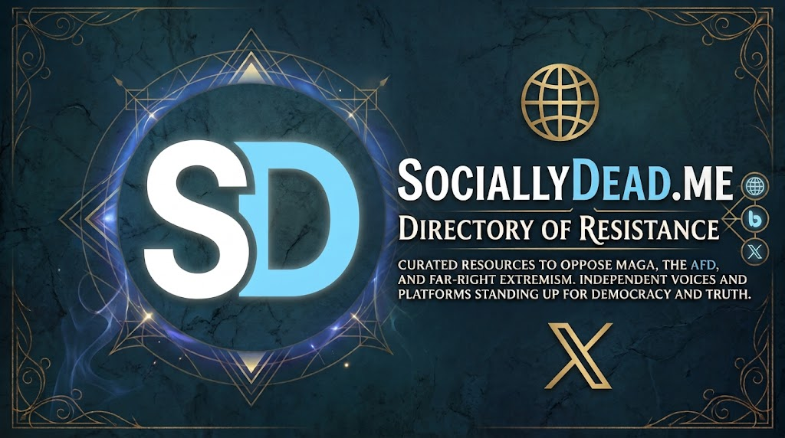

  <!-- HERO BANNER -->
  

    

  
  
  

***

## 🌐 Websites & Independent Media
*Platforms, watchdog organizations, and independent outlets exposing disinformation and opposing far-right authoritarianism.*

* **[Example Project / Watchdog](https://example.com)** – Fact-checking far-right rhetoric and tracking extremist networks.
* **[Independent News Outlet](https://example.com)** – Pro-democracy journalism analyzing populist shifts globally.

---

## 🦋 Bluesky Resisters
*Verified voices, journalists, and activists pushing back on Bluesky against MAGA, AfD, and right-wing extremism.*

* **[The White Witch™ (@thewhitewitchtm.sociallydead.me)](https://bsky.app/profile/thewhitewitchtm.sociallydead.me)** – Directory host & vocal activist opposing the far-right.
* **[Activists & Researchers](https://bsky.app/profile/example.bsky.social)** – Key voices analyzing right-wing movements and defending democratic values.

---

## 🅧 X (Twitter) Resistance
*Accounts countering misinformation and holding extremists accountable directly on X.*

* **[Resistance Watcher](https://x.com/example)** – Monitoring extremist organizing and debunking propaganda.
* **[Fact Check Initiative](https://x.com/example)** – Daily fact-checks targeting right-wing echo chambers.

***

### 🤝 How to Contribute
`sociallydead.me` is open source and community-driven! If you know of an independent website, Bluesky account, or X profile that stands against the far-right, you can:

1. **Submit a Pull Request** with your suggested additions.
2. **Open an Issue** on the [GitHub Repository](https://github.com/TheWhiteWitchTM/sociallydead) with details.
